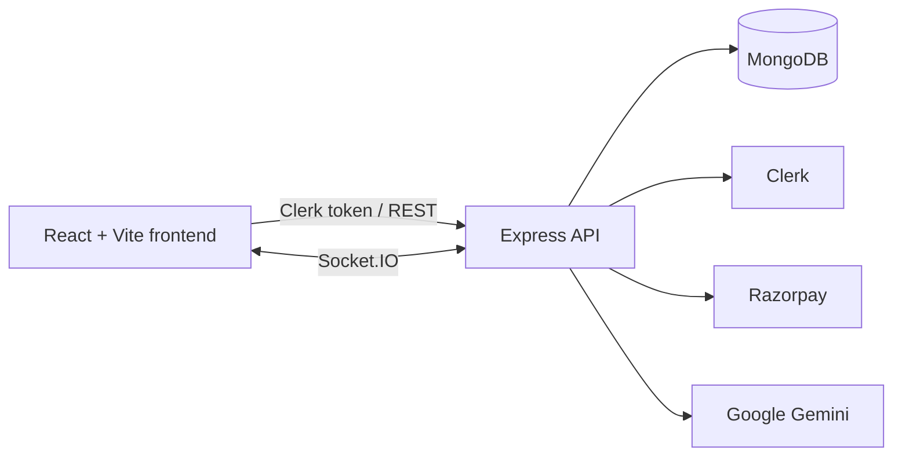

# LawConnect

> A full-stack legal services platform that connects clients with verified lawyers for consultations, case tracking, secure messaging, and payments.

LawConnect is a portfolio project focused on real product workflows rather than a static UI demo. It includes role-based dashboards, atomic consultation-slot booking, authenticated real-time chat, case timelines, document uploads, an AI legal assistant, and Razorpay payment flows.

[](frontend/)
[](backend/)
[](backend/src/models/)
[](backend/src/socket.js)

## What the product does

| User | Main workflows |
| --- | --- |
| Client | Discover lawyers, book consultations, pay fees, open cases, chat, upload documents, and follow hearing timelines |
| Lawyer | Manage profile and availability, accept bookings, manage cases, update hearings, communicate with clients, and track earnings |
| Admin | Review lawyers, monitor platform activity, manage users, and update transaction status |

### Core product flows

1. A client finds a verified lawyer and selects an available consultation slot.
2. The backend atomically reserves the slot to prevent double booking.
3. The lawyer approves the consultation and the case workspace becomes available.
4. Participants can exchange messages only when a valid consultation relationship exists.
5. Payments, notifications, case updates, and hearing events are persisted and synchronized in real time.

## Engineering highlights

- **Authentication and authorization**: Clerk sessions are synchronized with MongoDB profiles; middleware enforces authentication, roles, and verified-lawyer access.
- **Concurrency-safe booking**: MongoDB `findOneAndUpdate` reserves a slot only when it is still available, with rollback handling for downstream failures.
- **Secure realtime messaging**: Socket connections use short-lived server-signed tickets, and message delivery checks the participants' booking relationship.
- **Payments**: Razorpay orders are created and verified on the server; stored booking and case data determines payable amounts.
- **Resilient integrations**: MongoDB connection retries, graceful server shutdown, and an AI fallback responder keep local development usable.
- **Maintainable frontend**: Lazy-loaded routes, shared UI primitives, centralized API clients, role guards, and dedicated service modules.

Detailed design notes:

- [Booking and concurrency design](docs/SLOT_BOOKING_IMPLEMENTATION.md)
- [Authentication and session architecture](docs/SESSION_MANAGEMENT.md)
- [Messaging and Socket.IO flow](docs/MESSAGING_GUIDE.md)
- [Payment and realtime setup](docs/PAYMENT_AND_REALTIME_SETUP.md)

## Architecture



### Request and authorization flow

```text
Browser
  -> Clerk session token
  -> Express middleware
  -> MongoDB user/lawyer profile
  -> role and verification checks
  -> controller
  -> MongoDB / Razorpay / Socket.IO
```

## Repository map

```text
LawConnect/
├── backend/
│   ├── src/
│   │   ├── config/          Environment, CORS, and database setup
│   │   ├── controllers/     Business logic for auth, booking, cases, payments, and AI
│   │   ├── middleware/      Authentication and role guards
│   │   ├── models/          Mongoose schemas
│   │   ├── routes/          HTTP route declarations
│   │   ├── seed/            Development seed data
│   │   ├── app.js           Express application
│   │   ├── server.js        HTTP and Socket.IO startup
│   │   └── socket.js        Authenticated realtime messaging
│   └── scripts/             Diagnostics and smoke-test utilities
├── frontend/
│   ├── src/
│   │   ├── components/      Shared UI and dialogs
│   │   ├── context/         Authentication and application state
│   │   ├── hooks/           Reusable React hooks
│   │   ├── lib/             API, auth, payment, and socket clients
│   │   ├── pages/           Role-based product screens
│   │   └── App.jsx          Route tree and providers
│   └── scripts/             Local smoke-test utilities
├── custom-payment-gateway/  Standalone native Node.js payment prototype
├── docs/                    Setup guides and technical design notes
└── README.md
```

## Run locally

### Prerequisites

- Node.js 18 or newer
- npm 9 or newer
- MongoDB (local or Atlas)
- Clerk application credentials
- Razorpay test credentials for payment flows

### Install

```bash
git clone https://github.com/pawanxya/LawConnect.git
cd LawConnect

cd backend && npm install
cd ../frontend && npm install
```

### Configure environment

```bash
cp backend/.env.example backend/.env
cp frontend/.env.example frontend/.env
```

Fill in the values in both files. Never commit `.env` files or production secrets.

### Start the application

Run each service in a separate terminal:

```bash
# Terminal 1
cd backend
npm run dev

# Terminal 2
cd frontend
npm run dev
```

The frontend runs on `http://localhost:8080` and the API runs on `http://localhost:4000`. Verify the backend with:

```bash
curl http://localhost:4000/api/health
```

### Useful checks

```bash
cd frontend
npm run build
npm run lint

cd ../backend
node --check src/server.js
```

The repository also contains diagnostic and smoke-test commands under `backend/scripts/` and `frontend/scripts/`.

## API surface

The backend exposes focused route groups under `/api`:

| Group | Purpose |
| --- | --- |
| `/api/auth` | Clerk synchronization, login, profile, and session operations |
| `/api/lawyers` | Lawyer discovery, profiles, and availability |
| `/api/bookings` | Consultation creation, status changes, payments, and cancellation |
| `/api/cases` | Case records, fees, hearings, and timeline events |
| `/api/messages` | Persisted message history and message creation |
| `/api/payments` | Razorpay order creation and verification |
| `/api/notifications` | Notification retrieval and read state |
| `/api/ai` | Legal assistant chat and case summaries |
| `/api/socket/ticket` | Short-lived ticket for authenticated Socket.IO connections |

## Project documentation

- [Deployment checklist](docs/DEPLOYMENT.md)
- [Booking guide](docs/BOOKING_GUIDE.md)
- [Session management](docs/SESSION_MANAGEMENT.md)
- [Messaging guide](docs/MESSAGING_GUIDE.md)
- [Payment and realtime setup](docs/PAYMENT_AND_REALTIME_SETUP.md)
- [Slot booking implementation](docs/SLOT_BOOKING_IMPLEMENTATION.md)

## Demo assets

Product walkthrough videos are available in [`frontend/public/`](frontend/public/):

- [LawConnect demo](frontend/public/lawconnect-demo.mp4)
- [LawConnect product ad](frontend/public/lawconnect-ad.mp4)

## Security notes

- Keep Clerk secret keys, JWT secrets, MongoDB credentials, and Razorpay secrets on the server only.
- Use test payment keys during development.
- Do not treat the AI assistant as legal advice; it is a product feature for information and case summarization.
- Review [docs/DEPLOYMENT.md](docs/DEPLOYMENT.md) before deploying.

## License

MIT
